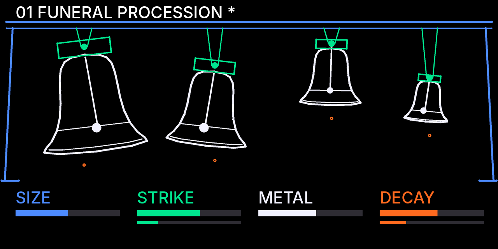

# The Bronze Choir

**An original synth engine for Opus 2 on the original OP-1 (firmware 246).**
*Designed exclusively for Opus by Nola Drift.*

Four bronze bells, synthesized in real time. There are no samples and no recordings. Each bell is a bank of decaying inharmonic sine modes (hum, prime, tierce, quint, nominal and the upper partials) with detuned doublets, damping that depends on frequency, an adjustable strike, and optional sympathetic resonance between the bells. On the T1 screen four line-art bells hang at different heights and swing whenever their register is played.



| | |
|---|---|
| Version | 1.1.0, native for Opus 2 beta 4 (see [CHANGELOG.md](CHANGELOG.md)) |
| Plugin id | `noladrift.bronzechoir` (engine `bronzechoir`) |
| Needs | Opus 2 beta 4 (core 2.21 or later), on an OP-1 with firmware 246. Built with the beta 4 RC1 plugin kit (core 2.30). For beta 3.x use 1.0.1 (commit `fb2e822`) |
| File | [`dist/bronzechoir.opmod`](dist/bronzechoir.opmod) (22,388 bytes) |
| Licence | GPL-3.0 (it is built with the GPL-3.0 Opus plugin kit) |

> **Status, honestly:** this engine has **not yet been run on an OP-1 or inside a real Opus core**, on beta 3.2 or beta 4. I had no device, and the Opus emulator has not been released yet. It builds clean with the Blackfin toolchain into a valid `.opmod`. The real engine sources passed all ten stress tests on a computer, and its CPU cost was measured in the Blackfin instruction simulator. All of that is described in [docs/TESTING.md](docs/TESTING.md). The `cpu.txt` figure is a simulator estimate and should be replaced with a device measurement. See [docs/KNOWN_LIMITATIONS.md](docs/KNOWN_LIMITATIONS.md).

## The four bells

The incoming note picks the bell: each register strikes its own bell. At the OP-1's normal octave (F2 to E4) the keyboard holds all four, six keys each, and every bell sounds an octave above the key.

| Bell | Register | Character | Modes |
|---|---|---|---|
| 1. The cathedral bell | keys below B2 | enormous, solemn, long hum | 13 |
| 2. The church bell | B2 to E3 | sharper tierce, brighter upper partials | 11 |
| 3. The ceremonial bell | F3 to A#3 | strong fundamental and twelfth, faint hum | 10 |
| 4. The chime | B3 and up | sparse, glassy, widely spaced partials | 8 |

## Controls (T1)

| Encoder | Plain turn | Shift + turn | Push |
|---|---|---|---|
| **Blue** | Size | | previous preset |
| **Green** | Strike | Sympathy | |
| **White** | Metal | | |
| **Orange** | Decay | Detune | next preset |

T2 shows the struck bell's modes live, as one line per mode at its log-frequency ratio, as tall as it is ringing. The details are in [docs/PARAMETERS.md](docs/PARAMETERS.md).

## Presets

01 Funeral Procession · 02 Bronze Garden · 03 The Ninth Bell · 04 Little Saint · 05 Cathedral Rain · 06 Distant Warning · 07 The Brass Procession · 08 Hollow Vespers.

Push orange for the next preset and blue for the previous one. The page shows the preset's name, with `*` once you have edited it. The values and the measured differences between the presets are in [docs/PRESETS.md](docs/PRESETS.md).

## Install

1. Connect the OP-1 in disk mode.
2. Copy `dist/bronzechoir.opmod` into the mods folder.
3. Eject and restart.
4. In Opus's mods list the row should say **loaded**. Choose *The Bronze Choir* as a synth engine.

For a first run, switch developer mode on (system settings). More steps, and how to build from source, are in [docs/INSTALL.md](docs/INSTALL.md).

## Media

- **Screenshots:** [`media/screenshots/`](media/screenshots/), nine PNGs: the four bells at rest, single and multiple bells swinging, shift-layer feedback, the T2 modes page, and the device mock-ups.
- **Demo and tour video:** [`media/the_bronze_choir_demo.mp4`](media/the_bronze_choir_demo.mp4), 1920×1080 at 30 fps, about 3 minutes. It covers the concept, all four bells, all six parameters, all eight presets, the modal architecture on T2 and a short performance. It opens and closes with the credit *Designed exclusively for Opus by Nola Drift*.

What these images are: both are drawn from the engine's **own page code** (`bc_page.c`) and its **own audio** (`bc_dsp.c`), run on a computer through a stand-in for the OS. They are not captures of an OP-1 screen. The device body is a mock-up, and the OP-1's screen font is approximated. You can rebuild the video with `python3 tools/make_video.py`; the timeline is in [docs/VIDEO.md](docs/VIDEO.md).

## Documentation

- [docs/INSTALL.md](docs/INSTALL.md): install, uninstall, build from source, the toolchain
- [docs/ARCHITECTURE.md](docs/ARCHITECTURE.md): the DSP, the modal tables, sympathy, the page, memory and the files
- [docs/PARAMETERS.md](docs/PARAMETERS.md): the six parameters and what each one does to the sound
- [docs/PRESETS.md](docs/PRESETS.md): the eight presets, their values and their measured character
- [docs/TESTING.md](docs/TESTING.md): the ten stress tests, the CPU measurements, the method, what was not tested
- [docs/KNOWN_LIMITATIONS.md](docs/KNOWN_LIMITATIONS.md): known limitations
- [docs/VIDEO.md](docs/VIDEO.md): the demo's timeline and a reproducible export workflow
- [CHANGELOG.md](CHANGELOG.md): version history

## Repository layout

```
engine/noladrift.bronzechoir/   the plugin: manifest, cpu.txt, bronzechoir.c (glue), bc_dsp.c (audio), bc_page.c (pages)
dist/bronzechoir.opmod          the built plugin
tools/                          make_tables.py (the bells' modal tables), analyze_presets.py, make_video.py
host/                           the engine on a computer: OS stand-in, score player, the ten stress tests, frame renderer
sim/                            CPU benchmark in the Blackfin instruction simulator (bfin-elf-run)
media/                          screenshots, the demo video, its score generator
third_party/opus-plugin-kit/    the vendored beta 3.2 Opus plugin kit (GPL-3.0, LizardMan), for 1.0.x only
```

Opus is by LizardMan. The Bronze Choir is an independent plugin by Nola Drift.
